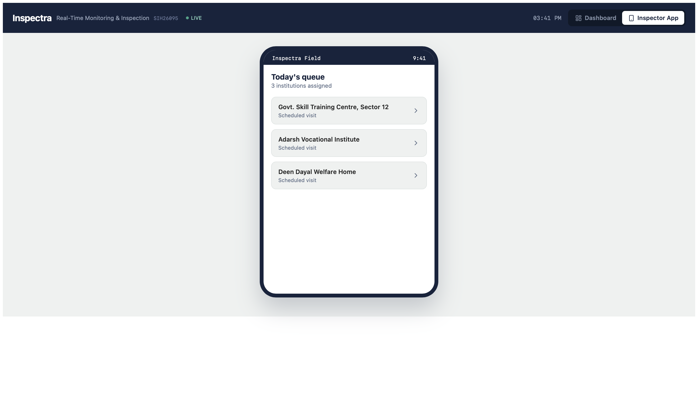
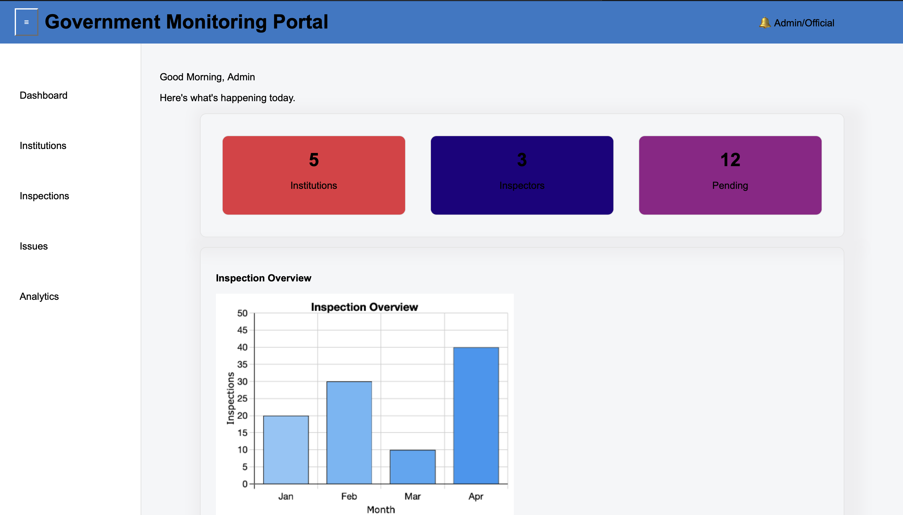
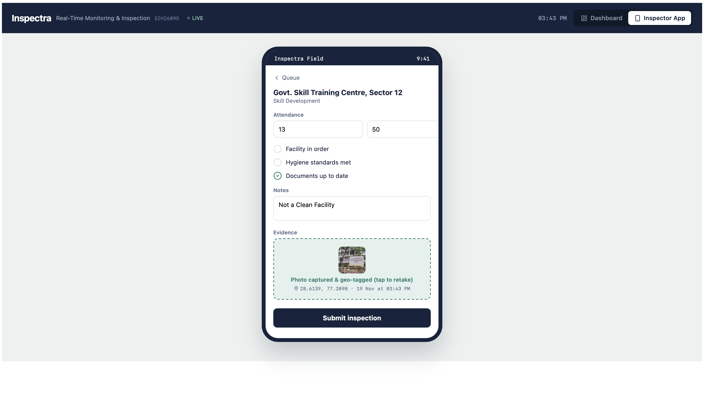
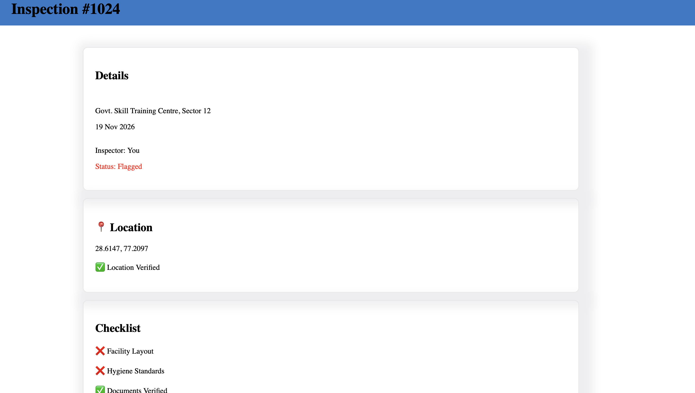
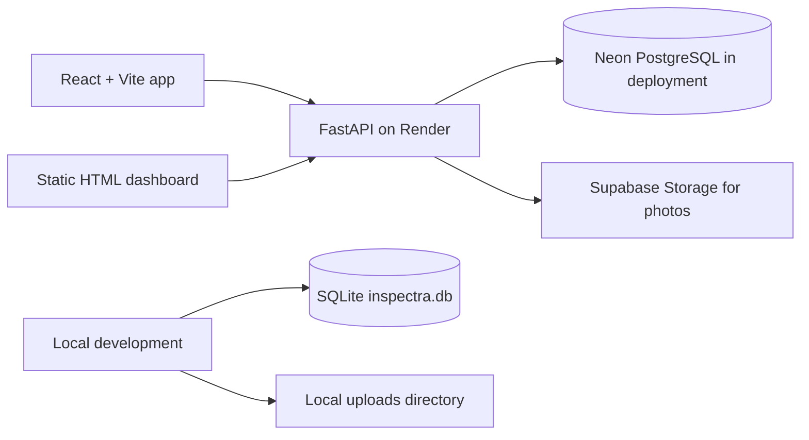

# Inspectra

Inspectra is an institution inspection and monitoring project for Smart India Hackathon problem statement **SIH26095**. It provides a field-inspection workflow and dashboards for viewing institutions, inspection results, risk scores, and pending surprise assignments.

**Live demos:** [React app](https://inspectra-phi.vercel.app) | [HTML dashboard](https://inspectra-dash.vercel.app) | [FastAPI](https://inspectra-api.onrender.com) ([API docs](https://inspectra-api.onrender.com/docs))

## Problem Statement

<!-- TODO: Paste the official SIH26095 problem statement text here. -->

<!-- TODO: Add the official problem statement theme/domain here. -->

## Features

- The React + Vite app has a monitoring dashboard and a phone-sized inspector workflow. It loads institution, inspection, and pending-assignment data from the API.
- The inspector workflow lets a user submit attendance, three checklist results, optional notes, and a required photo. The submitted inspector name is currently the literal value `You`.
- Inspection records include a timestamp, institution name, attendance and expected headcount, checklist results, notes, a flagged status, the prior risk score, coordinates, and a photo URL.
- An inspection is flagged if any of the facility, hygiene, or document checks fails, or if attendance is less than 70% of the expected count. A non-positive expected count is treated as an attendance ratio of 1 in the current calculation.
- On submission, the risk score is updated from the previous score and inspection findings. The implementation uses `round(previous_score * 0.5 + issues * 12 + attendance_penalty + status_adjustment)`, where `issues` counts failed checklist checks plus an attendance ratio below 0.7; `attendance_penalty` is 15 when the ratio is below 0.5 and 0 otherwise; `status_adjustment` is 10 when flagged and -6 otherwise. The result is clamped to 4-96.
- Surprise assignments select an institution randomly with higher-risk institutions given greater weight, then select an inspector name from the sample list in `seed_data.py`. Submitting an inspection removes the oldest pending assignment for that institution, if one exists.
- The separate HTML dashboard has dashboard, institution, inspection, analytics, issue, and detail pages. Its landing, institution-list, and inspection-list scripts fetch API data, and inspection-detail scripts also fetch inspection records. Analytics, issues, institution-detail pages, and the login form remain static sample UI rather than live analytics, issue management, or authentication workflows.

The risk score and flag are deterministic application rules, not an AI/ML prediction. Although inspection records contain coordinates, the backend currently generates a small random offset from the institution coordinates; it does not read the inspector device's GPS location.

## Screenshots and Demo





Workflow Demo video is present as a drive link in the docs folder with the file name `

## Architecture



The React app and static dashboard call the FastAPI service. The backend uses PostgreSQL when `DATABASE_URL` is configured and falls back to `./inspectra.db` when it is not. New photos are uploaded to the configured Supabase public bucket when Supabase settings are present; otherwise, they are saved under `backend/uploads/` and served from `/uploads/...`.

## Tech Stack

- **Backend:** Python, FastAPI 0.115.0, SQLAlchemy 2.0.35, Uvicorn 0.30.6, `python-multipart`, and `psycopg2-binary`.
- **Database:** PostgreSQL in the deployed setup; SQLite as the local fallback.
- **Photo storage:** Supabase Storage when configured; local filesystem fallback otherwise.
- **React app:** React 18, Vite 5, and `lucide-react`.
- **Additional UI:** Static HTML, CSS, and JavaScript in `SIH_dashboard/`.

## Project Structure

```text
.
|-- README.md
|-- SIH-main/
|   |-- backend/
|   |   |-- main.py
|   |   |-- crud.py
|   |   |-- models.py
|   |   |-- database.py
|   |   |-- seed_data.py
|   |   |-- migrate_sqlite_to_postgres.py
|   |   |-- requirements.txt
|   |   `-- .env.example
|   `-- frontend/
|       |-- src/ (App.jsx, api.js, main.jsx)
|       |-- index.html
|       |-- package.json
|       |-- package-lock.json
|       `-- vite.config.js
`-- SIH_dashboard/
		|-- index.html
		|-- config.js
		|-- dashboard/
		|-- institutions/
		|-- inspections/
		|-- analytics/
		|-- option-issues/
		|-- option-institutions/
		|-- Optioninspections/
		`-- login_page/
```

The HTML dashboard's `index.html` redirects to `dashboard/dashboard_index.html`. The login page is a static form only; there is no authentication implementation in the backend.

## Run Locally

Prerequisites: Python 3, Node.js with npm, and a shell. Start the backend and each frontend in separate terminals from the repository root.

### Backend

```bash
cd SIH-main/backend
python3 -m venv .venv
source .venv/bin/activate
pip install -r requirements.txt
uvicorn main:app --reload --port 8000
```

With `DATABASE_URL` unset, the backend creates/uses `SIH-main/backend/inspectra.db`. It creates missing tables when the application module loads. At startup it seeds the sample institutions and inspections only when the institution, inspection, and pending-assignment tables are all empty. The API docs are available at [http://localhost:8000/docs](http://localhost:8000/docs).

### React App

The frontend reads `VITE_API_URL` and defaults to `http://localhost:8000`.

```bash
cd SIH-main/frontend
npm install
npm run dev
```

Vite prints the local app URL, normally [http://localhost:5173](http://localhost:5173). To override the API origin, create `SIH-main/frontend/.env` using the example below. Vite loads frontend `.env` files automatically.

### Static HTML Dashboard

Serve the directory over HTTP (rather than opening the files directly), and point `config.js` at the local API:

```bash
cd SIH_dashboard
python3 -m http.server 5500
```

Before opening [http://localhost:5500](http://localhost:5500), temporarily set `window.API_URL` in `SIH_dashboard/config.js` to `http://localhost:8000`. The checked-in value points to the deployed API. If you set `CORS_ORIGINS` for the backend, include the local frontend origins as well.

### Environment Variables

Backend variables are read with `os.getenv`; the application does not load `.env` files itself. Export values in the shell or use a local environment loader. `DATABASE_URL` may be omitted for SQLite. Supabase is optional; when both `SUPABASE_URL` and `SUPABASE_SERVICE_ROLE_KEY` are omitted, uploads use local disk. If only one of those two settings is provided, photo uploads fail with a configuration error.

Safe template using the backend variable names (no real credentials):

```dotenv
# Leave DATABASE_URL unset for local SQLite; configure it privately for PostgreSQL.
# DATABASE_URL=<PostgreSQL URL; configure privately, never commit credentials>
CORS_ORIGINS=http://localhost:5173,http://localhost:5500
SUPABASE_URL=
SUPABASE_SERVICE_ROLE_KEY=
SUPABASE_STORAGE_BUCKET=inspection-photos
```

The checked-in `SIH-main/backend/.env.example` lists the same variables and a placeholder PostgreSQL URL. Do not replace that placeholder with a real credential in a committed file. For the React app, `SIH-main/frontend/.env.example` contains:

```dotenv
VITE_API_URL=http://localhost:8000
```

For deployment, set `CORS_ORIGINS` to the comma-separated frontend origins, for example `https://inspectra-phi.vercel.app,https://inspectra-dash.vercel.app`. The backend trims whitespace and trailing slashes from each configured origin.

## API Reference

All application routes are under `/api`. Timestamps are epoch milliseconds; JSON property names are camelCase.

| Method | Path | Purpose | Request / response notes |
| --- | --- | --- | --- |
| `GET` | `/api/institutions` | List institutions | Includes category, coordinates, `riskScore`, CCTV status, and `lastInspection`. |
| `GET` | `/api/inspections` | List inspections, newest first | Includes inspection fields and `photoUrl`. |
| `GET` | `/api/pending` | List pending assignments | Includes institution, assigned inspector, type, and creation time. |
| `POST` | `/api/inspections` | Submit an inspection | Multipart fields: `institution_id`, `inspector`, `attendance`, `expected`, `facility_ok`, `hygiene_ok`, `documents_ok`, optional `notes`, and required `photo`. Returns `404` if the institution ID is unknown. |
| `POST` | `/api/pending/surprise` | Create a surprise inspection assignment | Returns the assignment; returns `400` if no institution exists. |

FastAPI's interactive documentation is available at `/docs`. Uploaded local files are served under `/uploads/...`. `POST /api/reset` is not implemented in the checked-in `backend/main.py`, so it is not available in this version and is intentionally not listed as an endpoint.

### Data and Seed Records

The seed data defines five example institutions across India: a skill development centre, vocational institute, welfare/residential home, livelihood mission centre, and SC/ST girls hostel. It also defines two example inspections and sample inspector names `R. Sharma`, `A. Verma`, `S. Iyer`, and `P. Nair`. The seed inspection rows have no photo URL; newly submitted inspections require a photo.

An institution stores its ID, name, category, latitude/longitude, risk score, CCTV status, and last-inspection timestamp. An inspection stores its institution and inspector, timestamp, attendance versus expected headcount, three checklist booleans, notes, flagged state, prior risk, coordinates, and photo URL. A pending assignment stores its institution, assigned inspector, type, and creation timestamp.

## Deployment

The owner-provided deployment locations are:

- **Backend:** Render Web Service using `SIH-main/backend` as its service directory and `uvicorn main:app --host 0.0.0.0 --port $PORT` as the start command.
- **React app:** Vercel project rooted at `SIH-main/frontend`: [inspectra-phi.vercel.app](https://inspectra-phi.vercel.app).
- **HTML dashboard:** Vercel project rooted at `SIH_dashboard`: [inspectra-dash.vercel.app](https://inspectra-dash.vercel.app).
- **Database:** Neon PostgreSQL, configured through the private `DATABASE_URL` environment variable.
- **Photos:** Supabase Storage. Set `SUPABASE_URL`, `SUPABASE_SERVICE_ROLE_KEY`, and optionally `SUPABASE_STORAGE_BUCKET`; the default bucket name in code is `inspection-photos`. The bucket must allow public reads for the generated public photo URLs to load.

Set Render's `CORS_ORIGINS` to the two Vercel origins, separated by a comma. Keep the Supabase service-role key and database URL in provider environment settings; neither belongs in frontend code or source control. The migration utility `SIH-main/backend/migrate_sqlite_to_postgres.py` copies SQLite tables to PostgreSQL and refuses to copy when destination tables already contain rows. The handoff describes it as a one-time migration of the original data; the checked-in script itself is a reusable guarded copy utility.

**Free-tier behavior:** The Render service may sleep when idle, so the first request after inactivity can take about 30-60 seconds. Supabase free projects may pause after roughly seven days of low activity; while paused, hosted photos will not load until the project is resumed. These timings and policies are deployment-plan caveats and may change with provider terms.

## Known Limitations

- There is no backend authentication or authorization. The inspector name in the React workflow is hard-coded as `You`. The separate HTML login page has no implemented login behavior.
- `POST /api/reset` is not implemented in the checked-in API. No reset operation is documented as available.
- Inspection coordinates are generated near the institution's stored coordinates; they are not captured from device GPS.
- The standalone HTML dashboard is only partly data-backed. Analytics/issues pages and several institution/inspection detail pages contain static sample content, and displayed sample counts or controls should not be interpreted as persisted system records.
- The backend's default local photo storage is on disk and may not be persistent across ephemeral hosting deployments. Configure Supabase for hosted photo storage.
- The API allows all origins when `CORS_ORIGINS` is unset; configure explicit origins for deployment.
- The risk score is a fixed heuristic in `crud.py`, not a validated risk model. Its exact behavior is described under Features.

<!-- TODO: Add owner-approved future work after the roadmap is confirmed. -->

## Team, Credits, and License

<!-- TODO: Add team name, member names, roles, and credits. -->

<!-- TODO: Add the official SIH theme and any acknowledgements required by the event. -->

<!-- TODO: Add a license after the owner selects one. No license is currently specified here. -->

## Remaining Placeholders and Unverified Details

- Official SIH26095 problem statement text and theme/domain.
- Screenshot images at `docs/screenshots/react-dashboard.png`, `docs/screenshots/react-inspector.png`, and `docs/screenshots/html-dashboard.png`.
- Demo video URL or file at `docs/demo.mp4`.
- Owner-approved future-work roadmap.
- Team name, member names, roles, and credits/acknowledgements.
- Project license.
- The requested `POST /api/reset` route is not verifiable as an implemented endpoint because it is absent from the current backend code; verify or implement it before documenting it as available.
- Render/Vercel/Neon/Supabase deployment URLs and free-tier details were supplied in the project handoff; application source alone cannot verify current provider state or policy.
